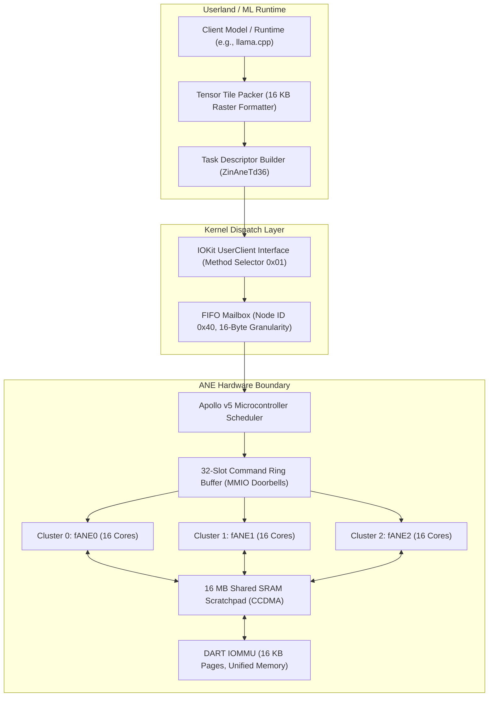

# Apple Neural Engine (ANE) Architecture & Driver Specification (H18)

[](#methodology--clean-room-statement)
[-orange.svg)](#key-hardware-invariants)
[](LICENSE)

An open, independent architectural specification and execution model for the **Apple Neural Engine (Generation H18 / Apollo v5)** on modern Apple Silicon architectures.

---

## Overview

The Apple Neural Engine (ANE) is Apple Silicon's dedicated on-chip coprocessor for accelerating tensor transformations and deep learning workloads. Traditionally accessible only through private layers under CoreML, this repository provides clean-room documentation of the underlying hardware layout, spatial memory tiling, task descriptor formats, and kernel dispatch mailbox protocols to facilitate standalone, bare-metal ML runtime development (such as native backends for `llama.cpp` or custom inference engines).

---

## System Architecture Pipeline

The diagram below illustrates the end-to-end execution path from a userland runtime down to the physical systolic array clusters:



---

## Key Hardware Invariants

| Parameter | Value | Technical Description |
| :--- | :---: | :--- |
| **Target SoC** | `t8150` | Apple Silicon A19 Pro |
| **Microcode Scheduler** | `Apollo v5` | 64-bit real-time coprocessor management core |
| **Physical Clusters** | `3` | Tri-cluster topology (`fANE0`, `fANE1`, `fANE2`) |
| **Neural Core Count** | `48` | 16 systolic cores per physical cluster |
| **Memory Tile Size** | `16 KB` (`0x4000`) | Atomic hardware memory transfer and cache footprint |
| **Tile Shift** | `14` | $\log_2(16384)$ bit-shift constant |
| **Vector Processing Width** | `32 channels` | Systolic Processing Element channel slice width |
| **Row Alignment** | `64 bytes` | Minimum DMA burst boundary for tensor rows |
| **FIFO Node ID** | `0x40` | Mailbox target identifier for command submissions |
| **Command Granularity** | `16 bytes` (`0x10`) | Command packet descriptor alignment requirement |
| **Hardware Queue Depth** | `32 slots` | 64-byte slots in kernel MMIO ring (2,048 bytes total) |

---

## 16 KB Memory Tile Geometry

The ANE does not address memory linearly. Instead, multi-dimensional tensors are partitioned into 16 KB memory tiles with strict 32-channel raster alignment.

For a 4D tensor with shape $[N, C, H, W]$ and element size $B = \text{sizeof(dtype)}$:

### 1. Row Stride ($R$)
Aligned to 64-byte DMA transfer boundaries:
$$R = \left\lceil \frac{W \times B}{64} \right\rceil \times 64$$

### 2. Plane Pitch ($P$)
Each single-channel spatial slice ($H \times R$) is padded to the 16 KB tile boundary:
$$\text{PlaneSize} = H \times R$$
$$P = \left\lceil \frac{\text{PlaneSize}}{16384} \right\rceil \times 16384$$

### 3. Channel Grouping
Channels are processed in hardware chunks of 32:
$$\text{ChannelGroups} = \left\lceil \frac{C}{32} \right\rceil$$

### 4. Total Buffer Allocation
$$\text{TotalBytes} = N \times \text{ChannelGroups} \times 32 \times P$$

---

## Repository Structure

```
apple-neural-engine-h18-re/
├── README.md                      # Project overview & architectural guide
├── LICENSE                        # MIT License
│
├── specs/                         # Machine-readable specifications (JSON)
│   ├── hardware_dispatch_spec.json  # FIFO mailbox parameters & channel mappings
│   ├── ane_isa_opcode_table.json    # Hardware command opcodes & tile geometry math
│   ├── hwx_container_spec.json      # ANEC container headers & task descriptor layouts
│   ├── symbol_inventory.json        # Class definitions & kernel dispatch selectors
│   ├── client_server_topology.json  # Client-to-driver IPC communication model
│   └── cross_validation_matrix.json # Numerical validation constants & comparisons
│
├── runtime/                       # Clean-room driver implementations
│   └── ane_direct_runtime.c       # C driver example (tile packing & submission)
│
├── tools/                         # Verification & automated test tooling
│   └── verify_ane_constants.py    # Independent validation script for hardware constants
│
└── docs/                          # In-depth technical engineering reports
    ├── 02_HWX_COMPILER.md         # Lowering pipeline & task descriptor dissection
    ├── 03_ISA_BYTECODE.md         # Hardware opcodes & tile transformation formulas
    └── 04_DRIVER_DISPATCH.md      # FIFO queue interfaces & DART IOMMU integration
```

---

## Independent Verification

The repository includes a standalone test script that asserts all hardware constants, formulas, and structural dimensions:

```bash
python3 tools/verify_ane_constants.py
```

Expected output:

```text
=== Apple Neural Engine (ANE) Hardware Constants Verification ===
  [PASS] FIFO Node ID == 0x40 (ANE_FIFO_NID)
  [PASS] Command Granularity == 16 bytes (0x10)
  [PASS] Command Ring Depth == 32 slots
  [PASS] Memory Tile Size == 16384 bytes (0x4000 / 16 KB)
  [PASS] Tile Shift == 14 (log2(16384))
  [PASS] Raster Channels per Tile == 32 channels
  [PASS] Row Stride Alignment == 64 bytes
  [PASS] H11ANEInUserClient Dispatch Table Count == 32 selectors
ALL ANE HARDWARE CONSTANTS & STRUCTURAL INVARIANTS VERIFIED: PASS
```

---

## Methodology & Clean-Room Statement

All specifications, mathematical formulations, and pseudocode implementations in this repository were developed exclusively through black-box structural analysis and clean-room systems research. No proprietary binaries, copyrighted code, or non-public Apple SDKs are distributed.

---

## License

Distributed under the [MIT License](LICENSE).
